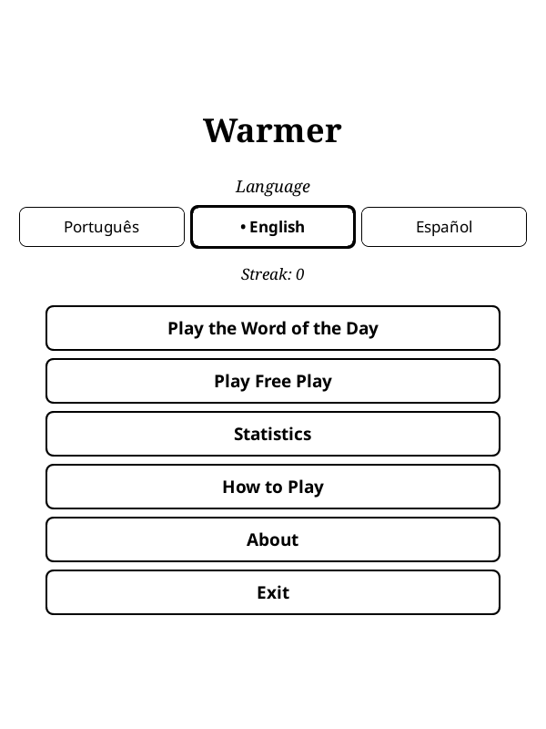
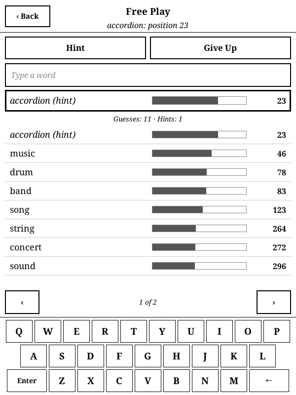
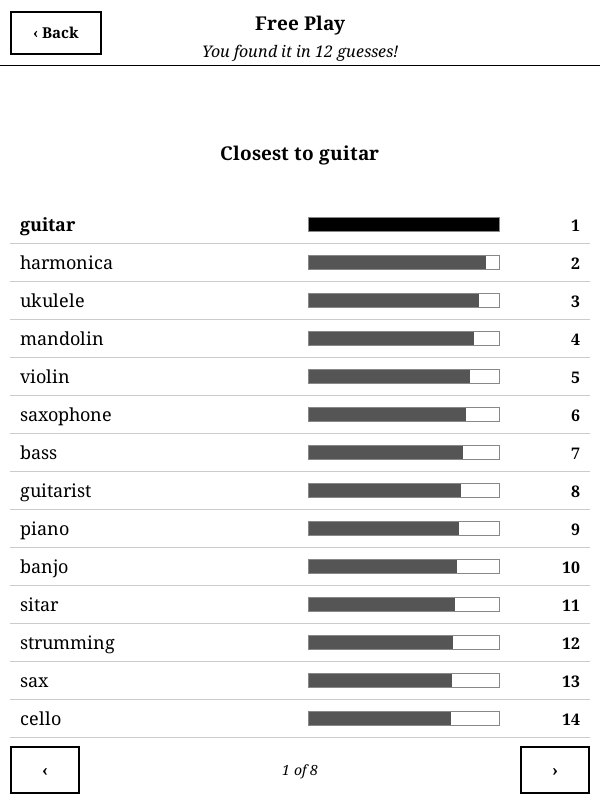

# Warmer

[Leia em português](README_pt.md)

Find the secret word by its meaning. Each guess shows how close it is. A word guessing game for [KOReader](https://koreader.rocks), in Portuguese, English and Spanish.

A game by [Beater Studios](https://beaterstudios.com/).

| Title | Game | Closest words |
|---|---|---|
|  |  |  |

## The game

- **Positions:** every guess gets a position in a ranking of closeness in meaning to the secret word. The secret word is position 1. The bar next to each guess shows how close it is.
- **Word of the day:** everyone playing the same language gets the same word, with no internet needed.
- **Free play:** random words, with no daily limit and no effect on your streak.
- **Hints:** a hint reveals a word halfway between your best guess and the secret word.
- **Give up:** reveals the secret word and the 100 words closest to it.
- **Three languages:** Portuguese, English and Spanish. The interface follows the language you pick.
- **Typing:** the game has its own keyboard, always on screen. Accents are optional and plurals count as their singular. Unknown words do not count, and a word sent again is shown where it already is in the list.
- **Statistics:** streak, wins and average guesses by language.
- **Sharing:** the daily result becomes a QR code that shows how close your guesses got, without revealing any word.
- **No internet:** it works offline and collects no data. Progress is saved after every guess.

## Installation

Each release has three packages. They play the same game and differ only in the size of the meaning data:

| Package | Size | |
|---|---|---|
| `warmer_game.koplugin.zip` | about 14 MB | Recommended. |
| `warmer_game.koplugin-100d.zip` | about 10 MB | Lighter. Close words come in a slightly different order. |
| `warmer_game.koplugin-300d.zip` | about 28 MB | Full data, the reference ranking. |

1. Download one of them from the [latest release](https://github.com/beater-studios/warmer_game.koplugin/releases/latest).
2. Extract it into `koreader/plugins/`, so that `koreader/plugins/warmer_game.koplugin/main.lua` exists.
3. Restart KOReader. The game is in the Tools menu, as **Warmer**.

To switch packages, extract another one over the same folder. Games in progress keep going, with positions recomputed. The About screen shows which data is installed, and the shared result includes it, so you know whether you are comparing the same ranking.

Progress is stored in `koreader/settings/warmer_game.lua`. To uninstall, delete the plugin folder and, if you wish, that file.

## Compatibility

- Tested in the KOReader emulator at 600x800, 758x1024, 1072x1448 and 1264x1680. The ranking speed and memory were measured on a 10th generation basic Kindle: under a second to start a game and about 11 MB of memory.
- Requires a touchscreen.
- The game always runs in portrait. Opened in landscape, it rotates the screen and restores the rotation on exit.

## Development

With [LuaJIT](https://luajit.org) installed, from the repository root:

```sh
luajit tools/validate_data.lua --no-vectors
luajit tests/engine_spec.lua
luajit tests/vectors_spec.lua
```

The meaning data is not in the repository: `tools/data/fetch_sources.sh` downloads the sources and `tools/data/build_data.py` builds them. The rules, the data, the remaining tools and the release process are described in [docs/design.md](docs/design.md). To suggest removing a word, open an issue. Contributions are accepted under the project's license.

## License

The code is under [GPL-3.0](LICENSE), version 3 only. You may use, study, modify and redistribute it, keeping it open under the same license.

The game data is adapted from the FastText word vectors by Meta and is distributed under CC BY-SA 3.0. Credits and licenses are in [NOTICE](NOTICE).

These terms grant no rights to the names "Warmer" and "Beater Studios". For other uses, contact [Beater Studios](https://beaterstudios.com/).
