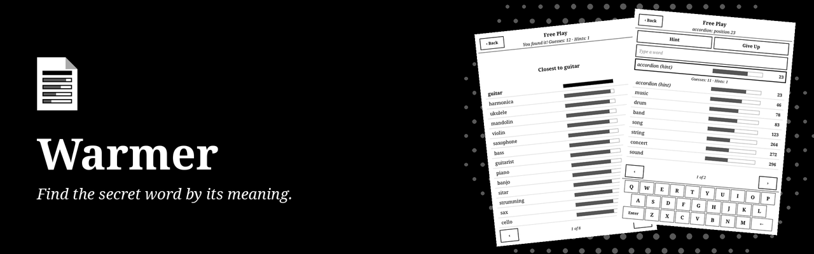
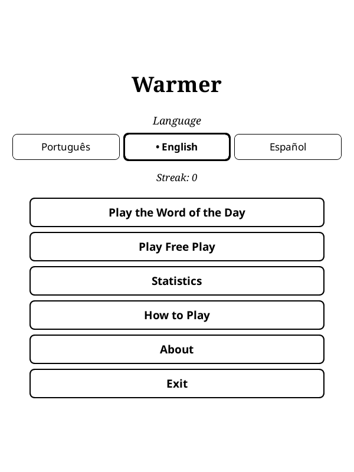
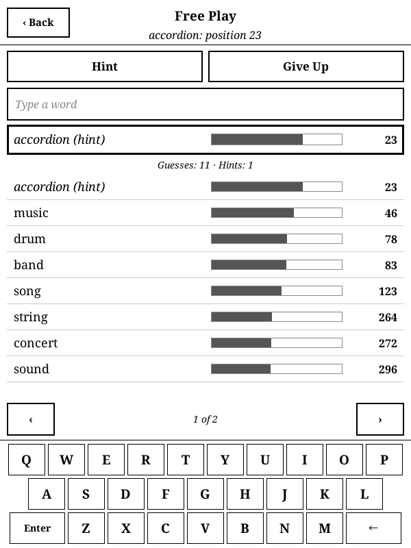
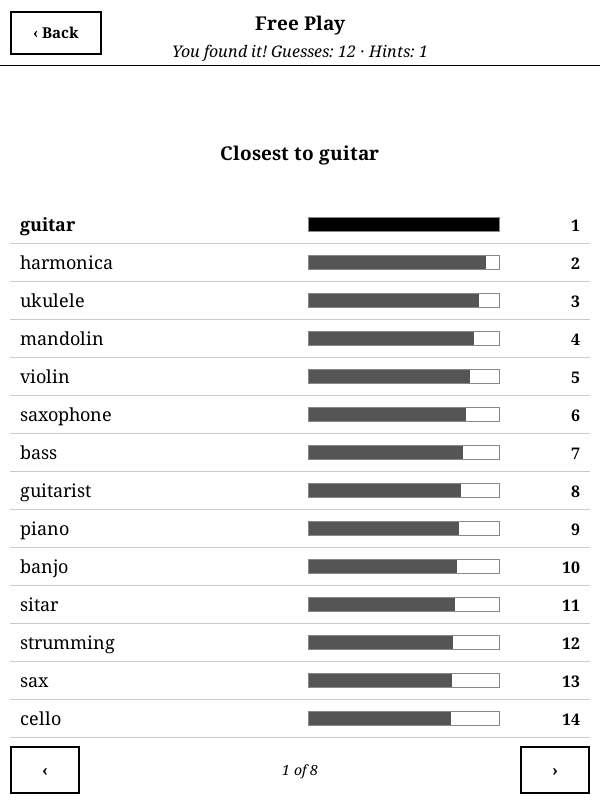
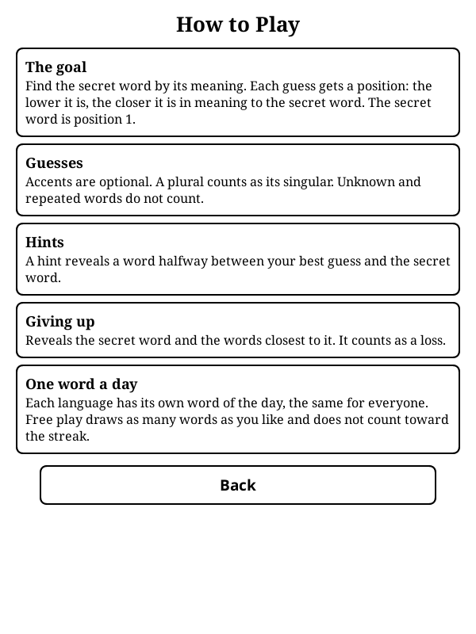

<p align="center">
  
</p>

<p align="center">
  <strong>Descubra a palavra secreta pelo sentido. Um jogo de adivinhar palavras para o KOReader, em português, inglês e espanhol.</strong>
</p>

<p align="center">
  <a href="https://github.com/beater-studios/warmer_game.koplugin/releases/latest"></a>
  <a href="https://github.com/beater-studios/warmer_game.koplugin/actions/workflows/ci.yml"></a>
  <a href="https://koreader.rocks"></a>
  
  <a href="LICENSE"></a>
</p>

<p align="center">
  <a href="#o-que-ele-faz">O que ele faz</a> ·
  <a href="#instalação">Instalação</a> ·
  <a href="#como-funciona">Como funciona</a> ·
  <a href="#desenvolvimento">Desenvolvimento</a> ·
  <a href="README.md">Read in English</a>
</p>

## O que ele faz

<table>
  <tr>
    <td width="25%" align="center"><br><sub><b>Início</b></sub></td>
    <td width="25%" align="center"><br><sub><b>Partida</b></sub></td>
    <td width="25%" align="center"><br><sub><b>Mais próximas</b></sub></td>
    <td width="25%" align="center"><br><sub><b>Como jogar</b></sub></td>
  </tr>
</table>

Cada palpite recebe uma posição num ranking de proximidade de sentido com a palavra secreta, que é a posição 1. Se a palavra secreta for "violão", "guitarra" fica na posição 5 e "casa" perto da 4.200: continue chutando até encontrar. O mesmo gênero do Contexto e do Semantle, feito para e-ink.

- **Palavra do dia:** quem joga no mesmo idioma recebe a mesma palavra, sem precisar de internet.
- **Modo livre:** palavras sorteadas, sem limite por dia e sem mexer na sequência.
- **Barras de proximidade:** cada palpite mostra a posição e uma barra em escala logarítmica, para os próximos se destacarem. A lista fica ordenada pela posição, com o último palpite no topo.
- **Teclado próprio:** sempre na tela, sem popup cobrindo a lista. Acentos são opcionais e o plural conta como singular. Uma palavra enviada de novo é mostrada onde já está na lista.
- **Dicas:** uma dica revela uma palavra na metade do caminho entre o seu melhor palpite e a palavra secreta.
- **Desistir:** revela a palavra secreta. No fim, veja as 100 palavras mais próximas dela.
- **Três idiomas:** português, inglês e espanhol, cada um com as próprias palavras. A interface segue o idioma escolhido.
- **Estatísticas:** sequência, vitórias e média de palpites por idioma.
- **Compartilhar:** o resultado da palavra do dia vira um QR code que mostra o quanto os palpites chegaram perto, sem revelar nenhuma palavra.
- **Tela de descanso:** se o aparelho dorme com o jogo aberto, aparece a capa do Warmer no lugar da capa do livro. Vale quando a tela de descanso do KOReader mostra a capa do livro.
- **Sem internet:** funciona offline e não coleta dados. O progresso é salvo a cada palpite.

## Instalação

Cada release tem três pacotes. O jogo é o mesmo; muda só o tamanho dos dados de sentido:

| Pacote | Tamanho | |
|---|---|---|
| `warmer_game.koplugin.zip` | cerca de 14 MB | **Recomendado.** |
| `warmer_game.koplugin-100d.zip` | cerca de 10 MB | Mais leve. As palavras próximas vêm numa ordem um pouco diferente. |
| `warmer_game.koplugin-300d.zip` | cerca de 28 MB | Dados completos, o ranking de referência. |

1. Baixe um deles na [última release](https://github.com/beater-studios/warmer_game.koplugin/releases/latest).
2. Extraia em `koreader/plugins/`, de modo que exista `koreader/plugins/warmer_game.koplugin/main.lua`.
3. Reinicie o KOReader. O jogo fica no menu Ferramentas, como **Warmer**.

Para trocar de pacote, extraia outro por cima da mesma pasta. As partidas em andamento continuam, com as posições recalculadas. A tela Sobre mostra quais dados estão instalados, e o resultado compartilhado também, para você saber se está comparando o mesmo ranking.

O progresso fica em `koreader/settings/warmer_game.lua`. Para desinstalar, apague a pasta do plugin e, se quiser, esse arquivo.

## Como funciona

Cada palavra do jogo é uma lista de números, um vetor de palavra, aprendida a partir de como a palavra é usada em bilhões de frases. Palavras usadas em contextos parecidos ganham números parecidos. Quando a partida começa, o Warmer compara a palavra secreta com todas as palavras que conhece, no próprio aparelho, e as ordena: essa ordem é o ranking.

<details>
<summary><b>Os dados e o aparelho</b></summary>

<br>

- **Vetores:** os vetores do FastText, da Meta, treinados no Common Crawl e na Wikipédia, reduzidos a 100, 150 ou 300 números por palavra e guardados com 1 byte cada.
- **Vocabulário:** cerca de 38 mil palavras em português, 32 mil em inglês e 29 mil em espanhol, todas formas de dicionário, sem nomes próprios nem palavras ofensivas.
- **Palavras secretas:** 750 por idioma, palavras comuns revisadas uma a uma, o que dá pouco mais de dois anos sem repetir a palavra do dia.
- **Num Kindle:** abrir uma partida leva menos de um segundo, e um palpite menos de um milissegundo. Só o idioma em jogo fica na memória, alguns megabytes, liberados ao sair da partida.
- **Offline:** nada é baixado nem enviado. Os dados vêm dentro do pacote.

As regras, o processo dos dados e as medições estão em [docs/design.md](docs/design.md), em inglês.

</details>

## Compatibilidade

- Feito para o KOReader 2026.07 e para telas sensíveis ao toque, sempre em retrato. Foi desenvolvido para um Kindle básico da 10ª geração (firmware 5.18.1).
- Layout conferido no emulador em 600x800, 758x1024, 1072x1448 e 1264x1680.
- Usa só o que vem com o KOReader, sem nada mais para instalar.

## Desenvolvimento

Com o [LuaJIT](https://luajit.org) instalado, a partir da raiz do repositório:

```sh
luajit tools/validate_data.lua --no-vectors
luajit tests/engine_spec.lua
luajit tests/vectors_spec.lua
```

Os dados de sentido não ficam no repositório: `tools/data/fetch_sources.sh` baixa as fontes em versões fixas e `tools/data/build_data.py` gera os dados. As regras, os dados, as demais ferramentas e o processo de release estão em [docs/design.md](docs/design.md), em inglês. Para sugerir a remoção de uma palavra, abra uma issue. Contribuições são aceitas sob a licença do projeto.

## Licença

O código está sob a [GPL-3.0](LICENSE), somente a versão 3. Você pode usar, estudar, modificar e redistribuir, mantendo-o aberto sob a mesma licença.

Os dados do jogo são adaptados dos vetores de palavras do FastText, da Meta, e são distribuídos sob CC BY-SA 3.0. Esta licença não dá direito aos nomes "Warmer" e "Beater Studios". Veja o [NOTICE](NOTICE).

---

<p align="center">
  <sub>Feito pela <a href="https://beaterstudios.com/">Beater Studios</a></sub>
</p>
